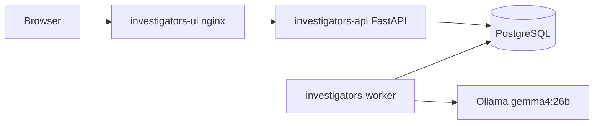
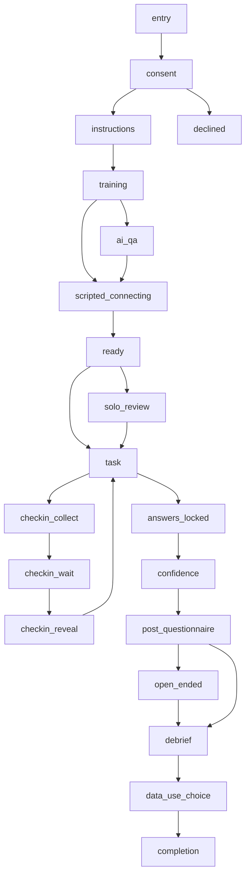
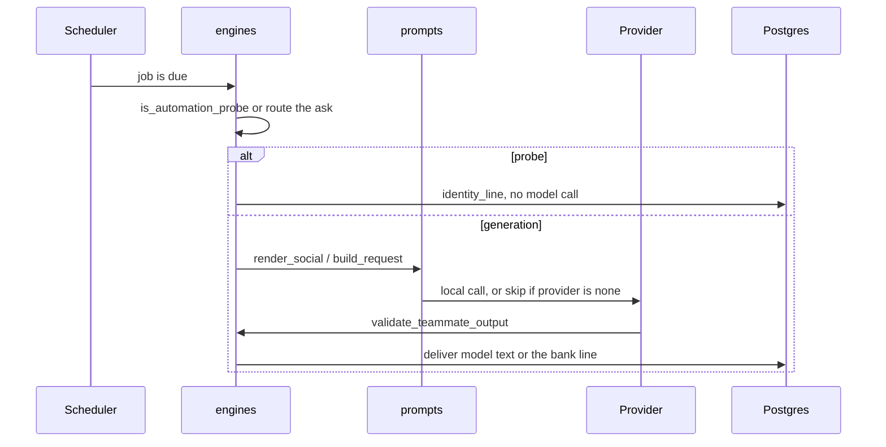

# Architecture

Four processes, from `docker-compose.yml`. The model service is optional for reading the code and is required only if you want generated replies. This source tree was not booted for the documentation.

State that survives a restart is in Postgres: the session row, the event log, scheduled jobs, and model-call records. The browser holds a view. It does not decide the next stage. `backend/app/domain/stage_graph.py` is the allowed transition set. The stage names are `STAGES` in `backend/app/db/schema.py`.

Peer evaluation uses `peer_ratings` and does not use the check-in. That branch is omitted from the diagram so the time-pressure path stays readable. The code, not this picture, is the authority. Some arrows depend on feature flags.

One teammate turn:

**Implemented** as the shape of the code. Not executed as a live session for this documentation.
